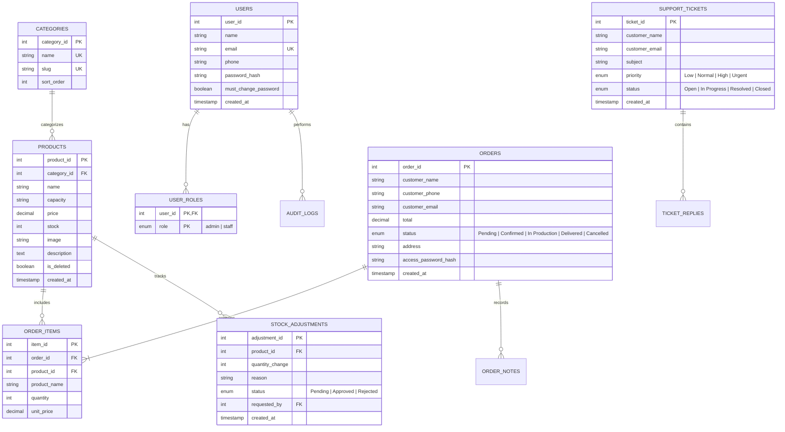

# Polar Fiber — E-Commerce & Management Platform

A modern, full-stack web application and operations management system for **Polar Fiber** (Addis Ababa, Ethiopia) — manufacturers of rotomolded and blow-molded food-grade water tankers with a 10-year warranty, fiber pipes, flower pots, and roofing sheets.

Built with **TanStack Start**, **React 19**, **Vite**, **Tailwind CSS v4**, and backed by **Aiven Cloud MySQL 8**.

---

## 📑 Table of Contents

- [Overview](#-overview)
- [Key Features](#-key-features)
- [Architecture & Tech Stack](#-architecture--tech-stack)
- [Role-Based Access Control (RBAC)](#-role-based-access-control-rbac)
- [Project Structure](#-project-structure)
- [Database & Schema](#-database--schema)
- [Authentication & Security](#-authentication--security)
- [API & Server Functions](#-api--server-functions)
- [Getting Started](#-getting-started)
  - [Prerequisites](#prerequisites)
  - [Environment Variables](#environment-variables)
  - [Database Setup & Seeding](#database-setup--seeding)
  - [Running the Development Server](#running-the-development-server)
- [Testing & Quality Assurance](#-testing--quality-assurance)
- [Deployment & Build](#-deployment--build)

---

## 🌟 Overview

Polar Fiber delivers durable, food-grade water storage solutions engineered to endure extreme temperature variations (-10°C to 60°C) without cracking or warping. This platform provides:

1. **A public storefront & brand portal** mirroring the design, product line, and aesthetic of the official brand.
2. **An instant quotation engine** allowing potential customers to submit project specifications and inquiries directly from any page.
3. **A complete e-commerce workflow** featuring client-side cart management and tamper-proof server-side order calculations in Ethiopian Birr (ETB).
4. **Public order tracking (`/track-order`)** for customers to verify order progress, delivery details, and item statuses using their order reference and secure access credentials.
5. **A protected administrative suite (`/admin`)** providing comprehensive management of products, categories, orders, dispatch workflows, customer inquiries, support tickets, inventory audits, and role-based operations.

---

## ✨ Key Features

### 🛒 Customer & Public Experience

- **Hero & Instant Quote**: Rapid quote request form integrated directly into the homepage banner and dedicated quote route (`/quote`).
- **Product Catalog (`/products`)**: Browse water tankers (500L to 25,000L), garden flower pots, fiber roof sheets, and fiber pipes with live pricing, stock availability, and image previews.
- **Product Details (`/products/$id`)**: Deep-dive product specifications (capacity, food-grade LLDPE material info, UV stabilization, price, and descriptions).
- **Persistent Shopping Cart (`/cart`)**: Local browser-persisted cart state with item quantity adjustments and instant ETB total calculations.
- **Secure Checkout & Order Placement**: Orders are placed with delivery address validation; order pricing is strictly re-computed against the live database on the server to prevent client-side price tampering.
- **Self-Service Order Tracking (`/track-order`)**: Customers track live order fulfillment stages (`Pending`, `Confirmed`, `In Production`, `Delivered`, `Cancelled`) with order reference code and security credentials.
- **Customer Inquiries & Contact (`/contact`)**: Submit general messages, quotation requests, and direct customer queries with rate limiting and automated logging.

### 🛡️ Administrative & Operations Suite (`/admin`)

- **Role-Tailored Dashboards**: Granular capability model distinguishing full Administrators from Operational Staff.
- **Product & Category Catalog**: Full CRUD over catalog items, category hierarchies, image galleries, and pricing controls (restricted to admin).
- **Order Pipeline & Dispatch Tracking**: Real-time order progress from receipt, internal team notes, payment confirmation, dispatch recording, through delivery confirmation.
- **Inventory & Stock Adjustments**: Monitor low stock, request stock adjustments, approve/reject adjustment requests with reason tracking, and inspect audit trails.
- **Quote Inquiries & Conversions**: View inbound quote requests, communicate with potential buyers, and convert quotes directly into confirmed orders.
- **Customer Messages & Support Tickets**: Manage contact messages (archive, reply, delete) and structured customer support tickets with priority levels and assignment workflows.
- **Analytics & Reporting**: Sales revenue charts, daily breakdowns, top 10 products sold, and low-stock reports with instant CSV exports.
- **System Settings & Team Management**: Configure business details, factory contact lines, user role assignments, password policies, and staff profiles.

---

## 🏗️ Architecture & Tech Stack

| Layer             | Technology                                                                 | Description                                                           |
| ----------------- | -------------------------------------------------------------------------- | --------------------------------------------------------------------- |
| **Framework**     | [TanStack Start](https://tanstack.com/start) + [Vite](https://vitejs.dev/) | Full-stack SSR and server functions framework built for React 19      |
| **Routing**       | [TanStack Router](https://tanstack.com/router)                             | Type-safe file-based client and server routing                        |
| **State & Cache** | [TanStack Query](https://tanstack.com/query)                               | Server-state caching, invalidation, and data synchronization          |
| **Styling**       | [Tailwind CSS v4](https://tailwindcss.com/) + Vanilla CSS tokens           | Fast utility classes paired with branded design tokens                |
| **UI Components** | [Radix UI](https://www.radix-ui.com/) & Lucide React                       | Accessible, headless UI primitives and iconography                    |
| **Database**      | [Aiven Cloud MySQL 8](https://aiven.io/)                                   | Managed MySQL instance with strict SSL/TLS encryption                 |
| **Driver**        | `mysql2/promise`                                                           | Connection-per-request edge-compatible database driver                |
| **Validation**    | [Zod](https://zod.dev/)                                                    | Strict input parsing and schema verification on client and server     |
| **Auth**          | Custom HMAC-SHA256 Sessions                                                | HttpOnly server-signed session cookies with bcryptjs password hashing |
| **Testing**       | [Vitest](https://vitest.dev/) + React Testing Library                      | Unit, security, and component integration tests                       |

---

## 👥 Role-Based Access Control (RBAC)

The platform implements a security model with distinct capabilities for **Administrators** and **Staff**:

| Capability / Section | Admin Role | Staff Role |
| :--- | :---: | :---: |
| **Financial Revenue & Sales Metrics** | Full Access | Hidden |
| **Product Pricing Edits** | Allowed | Read-Only (Field Disabled) |
| **Add / Delete Products** | Allowed | Hidden |
| **Order Status Workflow & Dispatch** | Allowed | Allowed |
| **Order Deletion & Refunds** | Allowed | Hidden |
| **Stock Movements & Request Adjustment**| Allowed | Allowed |
| **Approve / Reject Stock Adjustments** | Allowed | Hidden |
| **Archive Inquiries & Tickets** | Allowed | Allowed |
| **Delete Messages / Tickets** | Allowed | Hidden |
| **Company Business Settings** | Allowed | Hidden |
| **Team Management & Role Changes** | Allowed | Hidden |
| **My Profile & Password Change** | Allowed | Allowed (Sole Settings Tab) |

---

## 📁 Project Structure

```
polarfiber/
├── backend/                  # Server-only execution layer (never exposed to browser)
│   ├── api.functions.ts      # TanStack Start server functions (auth, catalog, orders, quotes, admin)
│   ├── db.server.ts          # MySQL connection lifecycle & SSL PEM normalizer
│   ├── email.ts              # SMTP mail delivery and templating
│   ├── session.server.ts     # Cookie signing (HMAC-SHA256), timingSafeEqual verification & RBAC
│   ├── server.ts             # Framework server entry & error boundaries
│   ├── start.ts              # TanStack Start router middleware with CSRF protection
│   ├── error-capture.ts      # Structured server-side error capturing
│   └── error-page.ts         # Server-rendered error recovery pages
│
├── frontend/                 # Client UI application (React 19)
│   ├── components/           # Reusable UI components
│   │   ├── ui/               # Base primitives (button, dialog, input, label, tabs, textarea, sonner)
│   │   ├── AdminDashboard.tsx# Comprehensive admin operations suite
│   │   ├── AdminSidebarLayout.tsx # Navigation sidebar with permissions-aware routing
│   │   ├── Can.tsx           # Declarative RBAC permission gate component
│   │   ├── OrderDrawer.tsx   # Detailed order view, notes, audit, and dispatch actions
│   │   ├── ProductCard.tsx   # Product display card with image and pricing
│   │   ├── ProductDialog.tsx # Product creation and editing modal
│   │   ├── QuoteForm.tsx     # Homepage and dedicated quote submission form
│   │   ├── SiteHeader.tsx    # Branded navigation header and footer
│   │   └── StatusBadge.tsx   # Visual status badge for orders and quotes
│   ├── routes/               # File-based routes (TanStack Router)
│   │   ├── __root.tsx        # Shell layout, QueryClientProvider, and global Toaster
│   │   ├── index.tsx         # Homepage with hero, quote form, about, and photo gallery
│   │   ├── about.tsx         # Company history, vision, and manufacturing standards
│   │   ├── products.index.tsx# Product catalog with category filter & sorting
│   │   ├── products.$id.tsx  # Product detail view
│   │   ├── cart.tsx          # Shopping cart & order placement
│   │   ├── login.tsx         # Staff & Administrator portal sign-in
│   │   ├── admin.tsx         # Operations dashboard route
│   │   ├── track-order.tsx   # Public guest order tracking by ID and password
│   │   ├── quote.tsx         # Standalone quote request page
│   │   └── contact.tsx       # Contact information, phone lines, and factory location
│   ├── routeTree.gen.ts      # Auto-generated TanStack route tree
│   ├── router.tsx            # Router factory initialization
│   ├── store.tsx             # Global client context (cart localStorage, current session user)
│   └── test/                 # Vitest test suites (routing, RBAC, orders, transitions)
│
├── shared/                   # Code shared across client and server
│   ├── data.ts               # TypeScript interfaces, constants (CATEGORIES, STATUSES), and ETB helper
│   ├── order-access.ts       # Secure password hashing and verification for guest tracking
│   └── order-status.ts       # State transition rules and validation for orders
│
├── utils/                    # Helper utilities
│   ├── audit.ts              # System audit log recorders
│   ├── notify.ts             # Email and operational notifications
│   ├── rate-limit.ts         # In-memory request rate limiting
│   ├── sanitize.ts           # Input sanitization and XSS prevention
│   └── stock.ts              # Inventory movement calculations
│
├── db/                       # Database migrations and scripts
│   ├── schema.sql            # Full MySQL DDL schema
│   ├── migrate.sql           # Schema migration updates
│   ├── migrate.mjs           # Automated migration runner
│   └── setup.mjs             # Database table creation and seeder script
│
├── public/                   # Static assets
│   ├── images/               # Branded product photography and hero imagery
│   └── favicon.ico           # Application favicon
│
├── .env                      # Local environment configuration (git-ignored)
├── aiven-ca.pem              # Aiven SSL Certificate Authority file
├── package.json              # Dependencies and execution scripts
├── vite.config.ts            # Vite build configuration with TanStack Start plugin
└── tsconfig.json             # TypeScript compiler settings
```

---

## 🗄️ Database & Schema

The system uses an **Aiven Cloud MySQL 8** instance with a normalized relational schema:



---

## 🔒 Authentication & Security

- **Session Cookies**: Upon login, a secure `pf_session` cookie is issued (`httpOnly: true`, `secure: true`, `sameSite: "lax"`, 14-day expiry).
- **HMAC Signatures**: Session payloads are signed on the server using `crypto.createHmac("sha256", SESSION_SECRET)`.
- **Timing-Attack Protection**: Cookie validation utilizes `crypto.timingSafeEqual` to safeguard against timing side-channel attacks.
- **Password Protection**: Passwords are encrypted using `bcryptjs` with 10 salt rounds.
- **Server-Side Authorization**: Every administrative endpoint enforces `requireAdmin()` or `requireStaffOrAdmin()` on the server; client-side UI restrictions cannot be bypassed.
- **Price Integrity**: Checkout reads `product_id` and recalculates subtotals directly from the database, ignoring any manipulated client price values.
- **Rate Limiting & Sanitization**: Public endpoints (order tracking, contact messages, quote requests) are protected by rate limiters and input sanitizers.

---

## 🔌 API & Server Functions

All endpoints are built using TanStack Start's type-safe `createServerFn`:

### Catalog & Public Services

- `getProducts` (`GET`): Returns full product list with joined category names.
- `getProduct` (`POST`): Returns a single product by `id`.
- `getCategories` (`GET`): Returns active categories sorted by display order.
- `placeOrder` (`POST`): Places an order with items and delivery address, supporting both staff checkout and guest checkout with order access credentials.
- `submitQuote` (`POST`): Records a quote inquiry linked to user or guest contact details.
- `getOrderStatusPublic` (`POST`): Allows guest order tracking by order reference and access credentials.

### Authentication & Sessions

- `getMe` (`GET`): Resolves the currently authenticated user and their active role (`admin` or `staff`).
- `login` (`POST`): Validates email and password, creates signed session cookie, returns user data.
- `logout` (`POST`): Clears session cookie and invalidates client query cache.
- `changePassword` (`POST`): Securely updates account password and clears password-reset flags.

### Admin & Staff Operations (`requireStaffOrAdmin` / `requireAdmin`)

- `getAdminOverview` (`GET`): Aggregates sales statistics, daily revenue, order statuses, and low-stock indicators.
- `getOrdersPage` (`GET`): Paginated order listing with status, search, and date filters.
- `saveProduct` (`POST`): Creates or updates catalog item details (requires admin).
- `deleteProduct` / `softDeleteProduct` (`POST`): Removes or archives products from the active catalog (requires admin).
- `setOrderStatus` (`POST`): Validates and advances order lifecycle states.
- `recordOrderDispatch` & `completeOrderDelivery` (`POST`): Logs fulfillment milestones with driver notes and timestamps.
- `getStockAdjustments`, `approveStockAdjustment`, `rejectStockAdjustment`: Stock governance workflow with reason logging.
- `getContactMessages` & `getSupportTickets`: Customer communication and ticketing inbox.
- `getCompanySettings` & `updateCompanySetting`: Business contact lines, address, and VAT registration configurations.
- `exportReportCSV` & `exportCustomersCSV`: Data exports formatted for auditing and accounting.

---

## 🚀 Getting Started

### Prerequisites

- **Node.js**: `v20.x` or higher
- **npm** or **bun**
- An active **MySQL 8** database (e.g., [Aiven Cloud MySQL](https://aiven.io/))

### Environment Variables

Create a `.env` file in the root directory:

```env
# Aiven MySQL Configuration
MYSQL_HOST=your-aiven-mysql-host.aivencloud.com
MYSQL_PORT=18349
MYSQL_USER=avnadmin
MYSQL_PASSWORD=your_secure_password
MYSQL_DATABASE=defaultdb

# Full Aiven CA Certificate (in PEM format or single line)
MYSQL_CA_CERT="-----BEGIN CERTIFICATE-----\nMIID...[CA CONTENT]...==\n-----END CERTIFICATE-----"

# Session Signing Key
SESSION_SECRET="your-cryptographically-secure-random-secret"

# Optional SMTP Mail Server Configuration
SMTP_HOST=smtp.example.com
SMTP_PORT=587
SMTP_USER=no-reply@example.com
SMTP_PASS=your-smtp-password
SMTP_FROM=Polar Fiber <no-reply@example.com>
```

> **Note**: The application automatically normalizes multiline or collapsed PEM certificates via `normalizeCa()` in `backend/db.server.ts`.

### Database Setup & Seeding

Initialize the database tables and populate sample products:

```sh
# Run database migrations and seed catalog items
node db/setup.mjs

# Run incremental migrations (if updating an existing database)
node db/migrate.mjs
```

### Running the Development Server

Start the local development server with Vite hot-reloading:

```sh
npm run dev
```

The application will be accessible at `http://localhost:3000`.

---

## 🧪 Testing & Quality Assurance

The test suite covers routing, RBAC permissions, storefront guest workflows, order state transitions, and server-side rules.

```sh
# Run full Vitest test suite
npm test

# Run tests in watch mode
npm run test:watch
```

---

## 📦 Deployment & Build

To build the application for production:

```sh
npm run build
```

The production output will be generated in the `.output/` directory, ready to deploy to Node.js environments or edge runtime platforms supporting TanStack Start.
