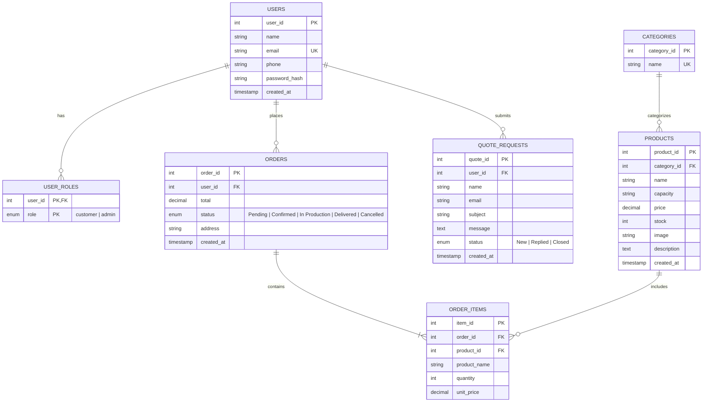

# Polar Fiber — E-Commerce & Management Platform

A modern, full-stack web application and operations management system for **Polar Fiber** (Addis Ababa, Ethiopia) — manufacturers of rotomolded and blow-molded food-grade water tankers with a 10-year warranty, fiber pipes, flower pots, and roofing sheets.

Built with **TanStack Start**, **React 19**, **Vite**, **Tailwind CSS v4**, and backed by **Aiven Cloud MySQL 8**.

---

## 📑 Table of Contents

- [Overview](#-overview)
- [Key Features](#-key-features)
- [Architecture & Tech Stack](#-architecture--tech-stack)
- [Project Structure](#-project-structure)
- [Database & Schema](#-database--schema)
- [Authentication & Security](#-authentication--security)
- [API & Server Functions](#-api--server-functions)
- [Getting Started](#-getting-started)
  - [Prerequisites](#prerequisites)
  - [Environment Variables](#environment-variables)
  - [Database Setup & Seeding](#database-setup--seeding)
  - [Running the Development Server](#running-the-development-server)
  - [Connecting via MySQL Workbench](#connecting-via-mysql-workbench)
- [Testing & Quality Assurance](#-testing--quality-assurance)
- [Deployment & Build](#-deployment--build)

---

## 🌟 Overview

Polar Fiber delivers durable, food-grade water storage solutions engineered to endure extreme temperature variations (-10°C to 60°C) without cracking or warping. This platform provides:

1. **A public storefront & brand portal** mirroring the design, product line, and aesthetic of the official brand.
2. **An instant quotation engine** allowing potential customers to submit project specifications and inquiries directly from any page.
3. **A complete e-commerce workflow** featuring client-side cart management and tamper-proof server-side order calculations in Ethiopian Birr (ETB).
4. **Customer self-service portal** for tracking past orders, order statuses, and quote requests.
5. **A protected administrative suite** providing complete CRUD over the product catalog, order status management, quote correspondence, and user auditing.

---

## ✨ Key Features

### 🛒 Customer & Public Experience

- **Hero & Instant Quote**: Rapid quote request form integrated directly into the homepage banner and dedicated quote route (`/quote`).
- **Product Catalog (`/products`)**: Browse water tankers (500L to 25,000L), garden flower pots, fiber roof sheets, and fiber pipes with live pricing, stock availability, and image previews.
- **Product Details (`/products/$id`)**: Deep-dive product specifications (capacity, food-grade LLDPE material info, UV stabilization, price, and descriptions).
- **Persistent Shopping Cart (`/cart`)**: Local browser-persisted cart state with item quantity adjustments and instant ETB total calculations.
- **Secure Checkout**: Orders are authenticated and placed with delivery address validation; order pricing is strictly re-computed against the live database on the server to prevent client-side price tampering.
- **Customer Dashboard (`/account`)**: Real-time overview of current and past orders with live status badges (`Pending`, `Confirmed`, `In Production`, `Delivered`, `Cancelled`) and submitted quote inquiries.

### 🛡️ Administrative Dashboard (`/admin`)

- **Product Catalog Management**: Create new products, edit existing items (name, category, capacity, price, stock, image, description), and remove discontinued lines.
- **Order Pipeline Tracking**: Monitor all customer orders and advance fulfillment stages from `Pending` through `Delivered`.
- **Quote Inquiries Desk**: View inbound quote requests, inspect customer contact details and messages, and mark statuses (`New`, `Replied`, `Closed`).
- **User Directory**: View registered customer profiles, contact phone numbers, roles, and historical order tallies.

---

## 🏗️ Architecture & Tech Stack

| Layer             | Technology                                                                 | Description                                                           |
| ----------------- | -------------------------------------------------------------------------- | --------------------------------------------------------------------- |
| **Framework**     | [TanStack Start](https://tanstack.com/start) + [Vite](https://vitejs.dev/) | Full-stack SSR and server functions framework built for React 19      |
| **Routing**       | [TanStack Router](https://tanstack.com/router)                             | Type-safe file-based client and server routing                        |
| **State & Cache** | [TanStack Query](https://tanstack.com/query)                               | Server-state caching, invalidation, and data synchronization          |
| **Styling**       | [Tailwind CSS v4](https://tailwindcss.com/) + Vanilla CSS tokens           | Fast utility classes paired with branded design tokens                |
| **UI Components** | [Radix UI](https://www.radix-ui.com/) & Lucide React                       | Accessible, headless UI primitives and iconography                    |
| **Database**      | [Aiven Cloud MySQL 8](https://aiven.io/)                                   | Managed MySQL instance with strict SSL/TLS encryption                 |
| **Driver**        | `mysql2/promise`                                                           | Connection-per-request edge-compatible database driver                |
| **Validation**    | [Zod](https://zod.dev/)                                                    | Strict input parsing and schema verification on client and server     |
| **Auth**          | Custom HMAC-SHA256 Sessions                                                | HttpOnly server-signed session cookies with bcryptjs password hashing |
| **Testing**       | [Vitest](https://vitest.dev/) + React Testing Library                      | Unit and component integration tests                                  |

---

## 📁 Project Structure

```
polarfiber/
├── backend/                  # Server-only execution layer (never exposed to browser)
│   ├── api.functions.ts      # TanStack Start server functions (auth, catalog, orders, quotes, admin)
│   ├── db.server.ts          # MySQL connection lifecycle & SSL PEM normalizer
│   ├── session.server.ts     # Cookie signing (HMAC-SHA256), timingSafeEqual verification & RBAC
│   ├── server.ts             # Framework server entry & error boundaries
│   ├── start.ts              # TanStack Start router middleware with CSRF protection
│   ├── error-capture.ts      # Structured server-side error capturing
│   └── error-page.ts         # Server-rendered error recovery pages
│
├── frontend/                 # Client UI application (React 19)
│   ├── components/           # Reusable UI components
│   │   ├── ui/               # Base primitives (button, dialog, input, label, tabs, textarea, sonner)
│   │   ├── ProductCard.tsx   # Product display card with image and pricing
│   │   ├── QuoteForm.tsx     # Homepage and dedicated quote submission form
│   │   ├── SiteHeader.tsx    # Branded navigation header and footer
│   │   └── StatusBadge.tsx   # Visual status badge for orders and quotes
│   ├── routes/               # File-based routes (TanStack Router)
│   │   ├── __root.tsx        # Shell layout, QueryClientProvider, and global Toaster
│   │   ├── index.tsx         # Homepage with hero, quote form, about, and photo gallery
│   │   ├── about.tsx         # Company history, vision, and manufacturing standards
│   │   ├── products.index.tsx# Product catalog with category filter & sorting
│   │   ├── products.$id.tsx  # Product detail view
│   │   ├── cart.tsx          # Shopping cart & order placement
│   │   ├── login.tsx         # Sign in and account registration tabs
│   │   ├── account.tsx       # Customer order & quote history portal
│   │   ├── admin.tsx         # Administrator operations dashboard
│   │   ├── quote.tsx         # Standalone quote request page
│   │   └── contact.tsx       # Contact information, phone lines, and factory location
│   ├── routeTree.gen.ts      # Auto-generated TanStack route tree
│   ├── router.tsx            # Router factory initialization
│   ├── store.tsx             # Global client context (cart localStorage, current session user)
│   ├── styles.css            # Global CSS styles, fonts, and responsive utilities
│   └── test/                 # Test suites and Vitest DOM setup
│
├── shared/                   # Code shared across client and server
│   └── data.ts               # TypeScript interfaces, constants (CATEGORIES, STATUSES), and ETB helper
│
├── db/                       # Database migrations and scripts
│   ├── schema.sql            # Full MySQL DDL schema
│   ├── setup.mjs             # Database table creation and product seeder script
│   └── test-connection.mjs   # Connectivity and SSL verification script
│
├── public/                   # Static assets
│   ├── images/               # Branded product photography and hero imagery
│   └── favicon.ico           # Application favicon
│
├── .env                      # Local environment configuration (git-ignored)
├── aiven-ca.pem              # Aiven SSL Certificate Authority file
├── package.json              # Dependencies and execution scripts
├── vite.config.ts            # Vite build configuration with TanStack Start plugin
└── tsconfig.json             # TypeScript compiler settings
```

---

## 🗄️ Database & Schema

The system uses an **Aiven Cloud MySQL 8** instance with the following normalized schema:



### Key Schema Design Decisions

1. **Separated `user_roles` Table**: Roles are isolated from the `users` table so profile edits cannot elevate privileges.
2. **Automatic First-User Admin Bootstrap**: During registration (`register` server function), the very first user created in the database is automatically assigned the `admin` role alongside `customer`.
3. **Historical Item Preservation**: `order_items` stores the item's unit price and product name at time of purchase. If a product is updated or deleted, past order records remain unchanged.
4. **Short-Lived Connections**: Each incoming request opens a clean MySQL connection and terminates it immediately via `withDb()` to suit serverless and edge hosting runtimes.

---

## 🔒 Authentication & Security

- **Session Cookies**: Upon login or registration, a secure `pf_session` cookie is issued (`httpOnly: true`, `secure: true`, `sameSite: "lax"`, 14-day expiry).
- **HMAC Signatures**: Session payloads are signed on the server using `crypto.createHmac("sha256", SESSION_SECRET)`.
- **Timing-Attack Protection**: Cookie validation utilizes `crypto.timingSafeEqual` to safeguard against timing side-channel attacks.
- **Password Protection**: Passwords are encrypted using `bcryptjs` with 10 salt rounds.
- **Server-Side Authorization**: Every administrative endpoint enforces `requireAdmin()` on the server; tampering with frontend state or routes cannot bypass server function protections.
- **Price Integrity**: Checkout reads `product_id` and recalculates subtotals from the database, ignoring any manipulated client price values.

---

## 🔌 API & Server Functions

All endpoints are built using TanStack Start's type-safe `createServerFn`:

### Catalog

- `getProducts` (`GET`): Returns full product list with joined category names.
- `getProduct` (`POST`): Returns a single product by `id`.

### Authentication & Sessions

- `getMe` (`GET`): Resolves the currently authenticated user and their active role.
- `login` (`POST`): Validates email and password, creates session cookie, returns user data.
- `register` (`POST`): Validates user info, creates account, assigns role (first account = admin), and sets session.
- `logout` (`POST`): Clears session cookie and invalidates client query cache.

### Orders & Quotes

- `placeOrder` (`POST`): Places an order with items and delivery address inside a database transaction.
- `submitQuote` (`POST`): Records a quote inquiry linked to authenticated user (or guest).
- `getMyAccount` (`GET`): Retrieves orders and quotes for the signed-in customer.

### Admin Operations (`requireAdmin`)

- `getAdminData` (`GET`): Aggregates all orders, quotes, products, and registered customers.
- `saveProduct` (`POST`): Inserts (if `product_id === 0`) or updates a product.
- `deleteProduct` (`POST`): Removes a product by ID.
- `setOrderStatus` (`POST`): Updates an order status.
- `setQuoteStatus` (`POST`): Updates a quote inquiry status.

---

## 🚀 Getting Started

### Prerequisites

- **Node.js**: `v20.x` or higher
- **npm** or **bun**
- An active **MySQL 8** database (e.g., [Aiven Cloud MySQL](https://aiven.io/))

### Environment Variables

Create a `.env` file in the root directory:

```env
# Aiven MySQL Configuration
MYSQL_HOST=your-aiven-mysql-host.aivencloud.com
MYSQL_PORT=18349
MYSQL_USER=avnadmin
MYSQL_PASSWORD=your_secure_password
MYSQL_DATABASE=defaultdb

# Full Aiven CA Certificate (in PEM format or single line)
MYSQL_CA_CERT="-----BEGIN CERTIFICATE-----\nMIID...[CA CONTENT]...==\n-----END CERTIFICATE-----"

# Session Signing Key
SESSION_SECRET="your-cryptographically-secure-random-secret"
```

> **Note**: The application automatically normalizes multiline or collapsed PEM certificates via `normalizeCa()` in `backend/db.server.ts`.

### Database Setup & Seeding

Initialize the database tables and populate sample products:

```sh
# Run database migrations and seed catalog items
node db/setup.mjs

# Verify database connection and SSL handshake
node db/test-connection.mjs
```

### Running the Development Server

Start the local TanStack Start development server:

```sh
npm run dev
```

The application will start on **`http://localhost:5173`** (or the port indicated in your terminal).

- Visit `/` to explore the public homepage.
- Visit `/login` to register an account. **The first user you register automatically becomes the system Administrator!**
- Access `/admin` when signed in as an administrator to manage products, orders, and inquiries.

### Connecting via MySQL Workbench

If you wish to view or administer the database through MySQL Workbench:

1. **Connection Method**: `Standard (TCP/IP)`
2. **Hostname**: Paste your `MYSQL_HOST`
3. **Port**: Paste your `MYSQL_PORT`
4. **Username**: `avnadmin` (or your `MYSQL_USER`)
5. **Password**: Click _Store in Vault..._ and paste `MYSQL_PASSWORD`
6. **SSL Tab**:
   - Set **Use SSL**: `Require and Verify CA` (or `Require`)
   - In **SSL CA File**: Browse and select the `aiven-ca.pem` located in the root of this project.
7. Click **Test Connection**.

---

## 🧪 Testing & Quality Assurance

Run the test suite powered by Vitest and JSDOM:

```sh
# Run tests once
npm test

# Run tests in watch mode
npm run test:watch
```

Run code quality and formatting checks:

```sh
# Linting
npm run lint

# Code formatting
npm run format
```

---

## 📦 Deployment & Build

To compile a production build:

```sh
# Build client and server bundles
npm run build

# Preview production build locally
npm run preview
```

The output bundle is optimized and ready for deployment to any Node.js or edge-compatible host supporting TanStack Start (e.g., Nitro, Vercel, Netlify, or Docker).

---

## 📄 License & Credits

Developed for **Polar Fiber** (Addis Ababa, Ethiopia).  
All product trademarks, imagery, and specifications belong to Polar Fiber.
